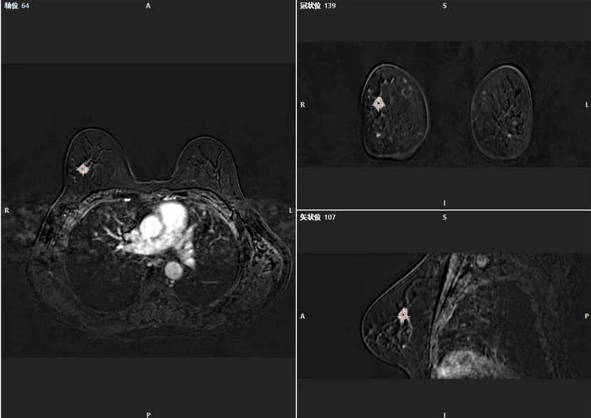
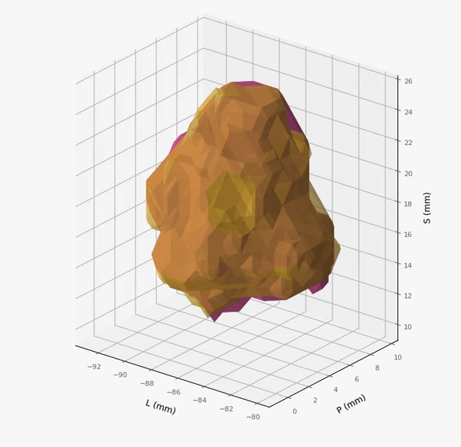

# Breast MRI Lesion Segmentation and Ki-67 Prediction

A research project on three-dimensional lesion segmentation from multiphase breast MRI and imaging-based prediction of Ki-67 expression. A desktop viewer supports image review and comparison of lesion masks.

> While the manuscript and related work are in preparation, this repository presents selected project progress. The source code is withheld during this stage.

## Research Workflow / 研究流程

- **Lesion localisation and segmentation.** MRI organ masks constrain the search region. A 3D residual U-Net localises candidate lesions, and an adapted Swin UNETR delineates the lesion volume.
- **Multiphase MRI fusion.** The segmentation model encodes differences between dynamic contrast-enhanced MRI phases and a reference phase, then incorporates these features through spatial gates.
- **Ki-67 prediction.** The project evaluates two approaches, one based on radiomic features and another combining DCE-MRI, ADC, DWI and T2 inputs. The prediction workflow compares the use of manual and automated lesion masks.

## Desktop Viewer Demonstrations / 可视化展示

### Linked Three-Plane MRI Review

Moving the crosshair in the axial view updates the linked coronal and sagittal slices so the same region can be inspected in all three planes.

### 3D Comparison of Lesion Masks

The viewer overlays the manual and automated lesion surfaces and rotates the result. The comparison makes areas of agreement and boundary differences visible from several angles.

